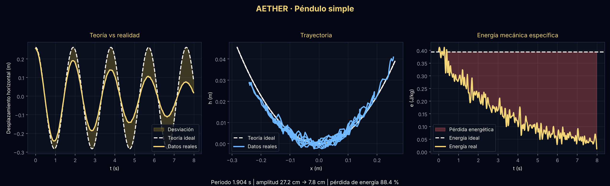

# Aether · Plataforma de Física con Inteligencia Artificial y Visión Artificial

> Proyecto universitario — **Universidad Nacional de las Ciencias Dr. Humberto Fernández Morán**

Aether es una aplicación web *mobile-first* que ayuda a estudiar física de dos maneras: resuelve problemas teóricos paso a paso con IA y analiza experimentos reales grabados en video, comparando lo que se midió con lo que predice la teoría.

## Equipo

| Integrante |
|---|
| Orianny Vargas |
| Daniela Rodriguez |
| Brayan Bravo |
| Jhonnyer Andrade |

## Qué hace

### Módulo A · Tutor de física con IA
- Recibe un enunciado en texto, una categoría (Cinemática, Dinámica, Leyes de Newton, Trabajo y Energía) y, opcionalmente, una imagen del problema.
- Gemini responde siempre en cuatro secciones: datos e incógnitas, fórmulas y principios, procedimiento paso a paso y resultado final en unidades del SI.
- Las ecuaciones se muestran con KaTeX.
- Genera un reporte PDF formal descargable (`/descargar-pdf`).

### Módulo B · Tracker-Vision & Error Auditor
- Se sube o se graba (desde el celular) un video corto de caída libre, péndulo o tiro parabólico.
- OpenCV sigue el objeto fotograma a fotograma y produce un video con la estela, las coordenadas y la rapidez en tiempo real.
- Muestra gráficas que comparan la curva teórica ideal con los datos reales, con la pérdida de energía sombreada.
- El **Auditor de Errores** (Gemini) redacta un informe científico que explica por qué la realidad difiere de la teoría: arrastre del aire, fricción, disipación de energía, incertidumbres de medición, etc.

### Extra · Script independiente
`aether_grafica.py` genera la gráfica teoría vs realidad directamente con Python, sin servidor web (ver [Uso del script](#script-de-gráfica-independiente)).



## Tecnologías

| Área | Herramientas |
|---|---|
| Backend | Python, Flask |
| Inteligencia artificial | Google Gemini (`google-genai`) |
| Visión artificial | OpenCV, NumPy |
| Reportes | ReportLab |
| Frontend | HTML5, Tailwind CSS, JavaScript, KaTeX, Marked |
| Configuración | python-dotenv |

## Requisitos

- Python 3.10 o superior
- Una clave de API de Gemini (gratis en <https://aistudio.google.com/apikey>)
- Conexión a internet (Tailwind, fuentes, KaTeX y Gemini se cargan desde la red)

## Instalación

```bash
git clone https://github.com/anny-sve/aether.git
cd aether

python -m venv .venv
.venv\Scripts\activate          # Windows
source .venv/bin/activate       # macOS / Linux

pip install -r requirements.txt
```

Crea tu archivo de configuración a partir del ejemplo:

```bash
copy .env.example .env          # Windows
cp .env.example .env            # macOS / Linux
```

Abre `.env` y pega tu clave en `GEMINI_API_KEY`. **Nunca subas el archivo `.env` a GitHub** (ya está en `.gitignore`).

## Ejecución

```bash
python app.py
```

- En la computadora: <http://127.0.0.1:5000>
- Desde el celular (misma red Wi-Fi): la dirección `http://<IP-de-tu-laptop>:5000` aparece en la terminal al iniciar.

## Variables de entorno

| Variable | Descripción | Valor por defecto |
|---|---|---|
| `GEMINI_API_KEY` | Clave de la API de Gemini | — (obligatoria) |
| `GEMINI_MODEL` | Modelo de Gemini a usar | `gemini-3.8-flash` |
| `SECRET_KEY` | Clave para firmar la sesión de Flask | valor local de desarrollo |
| `PORT` | Puerto del servidor | `5000` |

Si el modelo configurado no está disponible para tu clave, la aplicación prueba automáticamente modelos de respaldo.

## Script de gráfica independiente

```bash
python aether_grafica.py                                   # ejemplo simulado de caída libre
python aether_grafica.py --experimento pendulo             # ejemplo del péndulo
python aether_grafica.py video.mp4 --experimento caida --color rojo --alto 2.0
```

| Opción | Significado |
|---|---|
| `--experimento` | `caida`, `parabolico` o `pendulo` |
| `--color` | color del objeto (`rojo`, `naranja`, `amarillo`, `verde`, `azul`, `rosa`, `blanco`) o `auto` |
| `--alto` | alto real que abarca el video, en metros (define la escala) |
| `--lento` | factor de cámara lenta, si el video se grabó en slow motion |
| `--guardar` | nombre del PNG de salida |

## Consejos para grabar un buen video

- Cámara fija (trípode o apoyada) y encuadre perpendicular al movimiento.
- Objeto de color vivo (por ejemplo una pelota roja) sobre un fondo liso y bien iluminado.
- Mide el alto real que abarca el encuadre y escríbelo en metros: de eso depende la escala.
- 1080p a 30 o 60 fps es suficiente; videos más largos o en 4K solo hacen el análisis más lento.

## Estructura del proyecto

```
.
├── app.py                  Servidor Flask, Gemini, OpenCV y PDF
├── aether_grafica.py       Script independiente de la gráfica
├── requirements.txt        Dependencias
├── .env.example            Plantilla de configuración
├── templates/              Plantillas HTML (base, inicio, resultado, laboratorio, código)
├── static/
│   ├── css/aether.css      Estilos (glassmorphism, tema negro y dorado)
│   └── js/                 Controladores del tracker, gráficas y renderizado matemático
└── docs/                   Documentación detallada
```

## Documentación

- [Arquitectura y API](docs/ARQUITECTURA.md)
- [Fundamentos físicos y matemáticos](docs/FUNDAMENTOS_FISICOS.md)
- [Manual de usuario](docs/MANUAL_DE_USUARIO.md)
- [Guía para contribuir](CONTRIBUIR.md)

## Limitaciones conocidas

- El seguimiento por color necesita buen contraste; el modo `auto` (detección por movimiento) es menos preciso.
- Las magnitudes dependen de la escala que indique el usuario; un valor erróneo falsea la gravedad estimada.
- El auditor de errores y el tutor dependen de Gemini, por lo que requieren internet y una clave válida. Sus respuestas deben verificarse.
- El servidor integrado de Flask es solo para uso local y académico; no está pensado para producción.

## Licencia

Proyecto académico. El equipo aún no ha definido una licencia; hasta entonces todos los derechos quedan reservados a sus autores.
